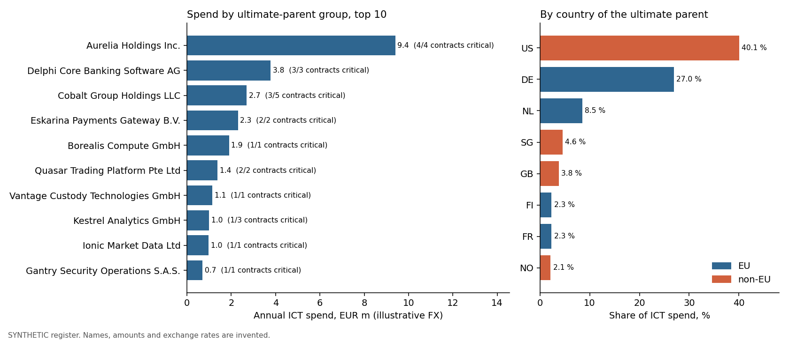

# DORA Register of Information: a validator measured against planted defects

A third-party-risk case. Under DORA (Regulation (EU) 2022/2554, Art. 28(3)) a financial entity keeps a register of all its
contractual arrangements with ICT third-party service providers and reports it to its supervisor. Before it does, can the
entity's own data pass the checks the supervisor will apply, and which providers is it most dependent on? This project
re-implements a subset of the published validation rules, runs them against a synthetic register with defects planted at known
places, and measures how many are found and how many alarms are false.

**Headline:** the validator caught **74 of 78 planted defects**, with **0 false alarms on the clean register**
(288 rows, 12 templates). 4 of the 78 defects cannot be seen by an offline rule set
by design (they need a registry lookup or a human) and are counted as missed; the other 74 were all caught. On the defective
register it raised 85 issues, every one of them on the answer key (precision 1.00, recall 1.00 on the lines that can be detected).
38 data-quality rules and 4 concentration flags are implemented;
22 of the 38 rules are built on a published EBA rule or technical check, quoted by ID.

| Deliverable | File |
|---|---|
| Issues report for a TPRM analyst: rule, severity, template, row, key, value, fix, EBA reference, with status and comment columns (Excel) | [`reports/dora_register_issues.xlsx`](reports/dora_register_issues.xlsx) |
| The same issues as CSV, and the clean-register run (empty) | [`reports/issues_defective_register.csv`](reports/issues_defective_register.csv), [`reports/issues_clean_register.csv`](reports/issues_clean_register.csv) |
| Concentration view: spend and criticality by provider group and by country, risk flags | [`reports/concentration.png`](reports/concentration.png), [`reports/concentration_by_group.csv`](reports/concentration_by_group.csv), [`reports/concentration_by_country.csv`](reports/concentration_by_country.csv), [`reports/risk_flags.csv`](reports/risk_flags.csv) |
| Rule catalogue with the published rule IDs | [`reports/rule_catalogue.csv`](reports/rule_catalogue.csv) |
| Answer key and per-rule scoring | [`data/synthetic/defective/answer_key.csv`](data/synthetic/defective/answer_key.csv), [`reports/evaluation_by_rule.csv`](reports/evaluation_by_rule.csv) |
| All numbers quoted here | [`reports/results.json`](reports/results.json) |
| SQL (DuckDB): referential integrity, cross-template consistency, concentration | [`sql/`](sql/) |



## Data

**Real and public (rules, structure, reference):**

| What | Source |
|---|---|
| Templates B_01.01 to B_07.01 and their content: Commission Implementing Regulation (EU) 2024/2956 (ITS on the register of information) | [https://eur-lex.europa.eu/eli/reg_impl/2024/2956/oj](https://eur-lex.europa.eu/eli/reg_impl/2024/2956/oj) |
| The register obligation and the concentration and exit-strategy provisions (Art. 28, 29) | [DORA, Regulation (EU) 2022/2554](https://eur-lex.europa.eu/eli/reg/2022/2554/oj) |
| Columns, keys, nullability and data types per template | [EBA, Data Model for DORA RoI (April 2025)](https://www.eba.europa.eu/sites/default/files/2025-04/035dd2b6-c7e3-4c7d-954f-6ffd41903de2/Data%20Model%20for%20DORA%20RoI.pdf) |
| Technical checks, DPM business validation rules and LEI/EUID/country checks, with their IDs | [EBA, Overview of the RoI reporting technical checks and validation rules (updated 28 April 2025)](https://www.eba.europa.eu/sites/default/files/2025-04/10100a51-275f-4c98-96a1-f81342a8f57d/Overview%20of%20the%20RoI%20reporting%20technical%20checks%20and%20validation%20rules%20%28updated%2028%20April%202025%29%20%284%29.xlsx) |
| Index of all EBA reporting material for the register (data point model, taxonomy, filing rules, FAQ) | [https://www.eba.europa.eu/activities/direct-supervision-and-oversight/digital-operational-resilience-act/preparation-dora-application](https://www.eba.europa.eu/activities/direct-supervision-and-oversight/digital-operational-resilience-act/preparation-dora-application) |
| LEI structure (ISO 17442) | [GLEIF](https://www.gleif.org/en/about-lei/iso-17442-the-lei-code-structure) |
| Six real, public LEIs, used only as test vectors for the check digits | [`data/reference/real_lei_samples.csv`](data/reference/real_lei_samples.csv) |

The EBA overview workbook lists 29 reception and CSV technical checks, 12 DPM technical checks, 71 DPM business validation rules (58 active,
13 inactive) and 8 LEI, EUID and country checks. The column codes (c0010, c0020 ...) in the synthetic files are the EBA's own.

**Synthetic (the register under test):** `Meridian Beispielbank Group (SYNTHETIC)`, reference date 2025-12-31, generated by
[`src/dorarv/generate.py`](src/dorarv/generate.py) with a fixed seed. Every name, code and amount is invented; the LEIs carry valid check
digits and the prefix SYNT and are not registered anywhere. No real company data is presented as real.

| | Clean register | Defective register |
|---|---|---|
| Files | [`data/synthetic/clean/`](data/synthetic/clean/) | [`data/synthetic/defective/`](data/synthetic/defective/) |
| Rows per template | B_01.01 1, B_01.02 14, B_01.03 3, B_02.01 39, B_02.02 38, B_03.01 39, B_03.02 39, B_04.01 36, B_05.01 24, B_05.02 8, B_06.01 22, B_07.01 25 | the same, plus a few appended rows |
| Contents | 14 entities, 36 contracts (plus 3 master agreements), 24 providers, 22 functions (14 critical), supply chains, assessments | 78 planted defects, see `answer_key.csv` |

## Results

### 1. The rule set

38 data-quality rules across 6 families, 15 of them in DuckDB SQL because they join templates:

| Family | Rules |
|---|---:|
| Completeness | 3 |
| Format | 9 |
| Date logic | 4 |
| Conditional | 7 |
| Referential integrity | 7 |
| Cross-template | 8 |

How close each rule is to the published one (column `basis` in the catalogue):

| Basis | Rules | Meaning |
|---|---:|---|
| EBA | 15 | A published rule or technical check, same logic |
| EBA-family | 3 | A family of published rules with one shared logic, implemented once |
| EBA-offline | 3 | A published rule that needs the GLEIF or BRIS register; an offline proxy is implemented |
| EBA-inactive | 1 | A published rule the EBA deactivated in March 2025, kept as a data-quality rule |
| ITS | 8 | Follows the templates or DORA text, no published rule ID |
| custom | 8 | This project's own consistency check |

The EBA marks every DPM business rule as a warning; the `error` / `warning` column here is a separate judgement: error means the value is unusable or the file
would not load (format, key, mandatory field, foreign key), warning means a business-logic or consistency finding.

### 2. Measured against the answer key (defective register)

| | |
|---|---:|
| Defects planted | 78 |
| In scope for an offline rule set | 74 |
| Caught | 74 |
| Key lines (rule, template, row) that should be raised | 85 |
| Key lines raised | 85 |
| Issues raised in total | 85 |
| False alarms (issues not on the key) | 0 |
| False alarms on the clean register | 0 |

A defect is caught only when every issue it should cause is raised. 78 defects give 85 key lines because some defects legitimately trigger
several rules: an LEI typo breaks the check digits and the foreign key, a provider total off by 25 % breaks the reconciliation.

| Rule family | Rules planted against | Planted | Raised on target | False alarms |
|---|---:|---:|---:|---:|
| Completeness | 2 | 9 | 9 | 0 |
| Format | 9 | 27 | 27 | 0 |
| Date logic | 4 | 8 | 8 | 0 |
| Conditional | 7 | 9 | 9 | 0 |
| Referential integrity | 7 | 16 | 16 | 0 |
| Cross-template | 8 | 16 | 16 | 0 |

DRV-01 (empty template) cannot be planted without deleting a file, so it is tested in `tests/` only. The 4 defects outside the reach of the rules, all missed:

| ID | Defect | Where |
|---|---|---|
| D01 | A critical function was marked non-critical and its assessment removed (a consistent but wrong judgement) | B_06.01 row 12 |
| D02 | Parent LEI is well-formed and has valid check digits but belongs to an unrelated entity | B_01.02 row 13 |
| D03 | Contract expense is ten times too high in both B_02.01 and the provider total (internally consistent) | B_02.01 row 6 |
| D04 | Governing-law country is wrong (DE instead of US) but a valid code | B_02.02 row 24 |

These are the useful ones to read. A well-formed LEI with correct check digits can still belong to the wrong company; two numbers that agree can both be wrong; a
valid country code can be the wrong one. Offline rules do not find these, a GLEIF lookup or a reviewer with the contract might.
Because the same author wrote the rules and the key, the score shows that the implementation does what was intended, not that real registers hold no other kind of defect (see limits).

### 3. What the analyst gets

85 issues on the defective register: 57 errors and 28 warnings, from 37 different rules. Each row carries the rule, the severity, the template, the CSV
row, the key of the record, the offending value, a message, a suggested fix and the EBA reference. Issues by template:

| Template | Issues |
|---|---:|
| B_01.01 | 2 |
| B_01.02 | 11 |
| B_01.03 | 3 |
| B_02.01 | 7 |
| B_02.02 | 21 |
| B_03.01 | 3 |
| B_03.02 | 2 |
| B_04.01 | 3 |
| B_05.01 | 13 |
| B_05.02 | 4 |
| B_06.01 | 6 |
| B_07.01 | 10 |

Examples (the fix column is what the analyst sees):

| Severity | Rule | Where | Message | Fix |
|---|---|---|---|---|
| error | DRV-31 | B_01.01 row 2 | Entity LEI SYNT9F4L7AXYOEYZGC4 is not in B_01.02 | Fix the LEI, or add the entity to B_01.02. |
| error | DRV-05 | B_01.02 row 5 | 'SYNT9F4L7AXYOEYZGC42' fails the ISO 17442 check digits: c0060 LEI of the direct parent undertaking | The ISO 17442 check digits do not match: a typo. Copy the LEI from the GLEIF record. |
| warning | DRV-43 | B_02.02 row 32 | Contract supports a critical or important function but has no row in B_07.01 | B_07.01 is completed for contracts supporting critical or important functions, and only for those. |
| warning | DRV-46 | B_05.01 row 16 | Provider total 187500 EUR but its 1 contracts add up to 150000.0 | Reconcile B_05.01 total expense with the contract expenses in B_02.01 (same currency). |
| warning | DRV-45 | B_07.01 row 20 | Highly complex substitutability provider supporting a critical function, without an exit plan | DORA Art. 28(8) expects an exit strategy for critical services. Confirm the plan exists or set it up. |

### 4. Concentration (clean register)

Total annual ICT spend 30.2 m EUR (fixed illustrative exchange rates), 21 provider groups after rolling providers up to their ultimate parent.
**Aurelia Holdings Inc. takes 31.2 % of the spend and supports 4 critical functions**; the top three groups take 52.6 %.
By country of the ultimate parent, **US accounts for 40.1 %**, although the largest provider is incorporated in Ireland.

| Provider group (ultimate parent) | Country | Spend, EUR m | Share | Critical functions supported |
|---|---|---:|---:|---:|
| Aurelia Holdings Inc. | US | 9.4 | 31.2 % | 4 |
| Delphi Core Banking Software AG | DE | 3.8 | 12.5 % | 3 |
| Cobalt Group Holdings LLC | US | 2.7 | 8.9 % | 3 |
| Eskarina Payments Gateway B.V. | NL | 2.3 | 7.6 % | 2 |
| Borealis Compute GmbH | DE | 1.9 | 6.3 % | 1 |

3 of 14 critical functions depend on a single provider.
Flags raised (thresholds are illustrative, not regulatory): CON-01 provider group at or above 20% of spend: 1;
CON-02 group supporting 4 or more critical functions: 1;
CON-03 one non-EU jurisdiction at or above 30% of spend: 1; CON-04 critical function with one provider: 3.
Flags are risk signals for a review, not data errors, so they sit in their own sheet and do not count as validator issues.

## Method

| Step | File |
|---|---|
| Data model (columns, kinds, keys) taken from the EBA data model | [`src/dorarv/model.py`](src/dorarv/model.py) |
| Rule catalogue with published IDs, basis and fix text | [`src/dorarv/rules.py`](src/dorarv/rules.py) |
| Single-template rules: mandatory fields, keys, LEI format and check digits, country, currency, dates, numbers, closed lists, conditional fields | [`src/dorarv/checks.py`](src/dorarv/checks.py), [`src/dorarv/lei.py`](src/dorarv/lei.py) |
| Cross-template rules in DuckDB: foreign keys, contract-provider-function consistency, criticality and substitutability, exit plans, expense reconciliation, supply chain | [`sql/10_referential.sql`](sql/10_referential.sql), [`sql/20_consistency.sql`](sql/20_consistency.sql) |
| Concentration by group, country and critical function | [`sql/30_concentration_by_group.sql`](sql/30_concentration_by_group.sql), [`sql/31_concentration_by_country.sql`](sql/31_concentration_by_country.sql), [`sql/32_critical_function_dependency.sql`](sql/32_critical_function_dependency.sql), [`src/dorarv/concentration.py`](src/dorarv/concentration.py) |
| Synthetic register, defect injection, answer key | [`src/dorarv/generate.py`](src/dorarv/generate.py) |
| Scoring against the key | [`src/dorarv/evaluate.py`](src/dorarv/evaluate.py) |
| Reports, Excel, chart, this README | [`src/dorarv/report.py`](src/dorarv/report.py), [`build.py`](src/dorarv/build.py), [`readme.py`](src/dorarv/readme.py) |
| Validate any folder of template CSVs | `python -m dorarv.cli <folder> --out issues.csv` |
| Tests: every rule fires on a planted defect and stays silent on the clean register, LEI check digits (real and generated codes), rule IDs exist in the catalogue, SQL runs, README figures equal `results.json` | [`tests/`](tests/) |

Choices worth defending:

- **The key is scored per rule, template and row**, not per file. A validator that says "something is wrong somewhere" would score full marks per file and be useless to an analyst.
- **Cascades are written into the key.** A planted LEI typo must produce both the check-digit issue and the foreign-key issue; anything else on the report is a false alarm.
- **Out-of-scope defects are planted on purpose and counted as misses.** Without them a score of 74 of 78 would be easy and uninformative.
- **Foreign keys are checked with anti-joins on text keys**, not joins, so a duplicate row cannot fan out and create or hide issues.
- **Contract to provider comes from B_03.02** (the signing provider); B_02.02 must agree with it (DRV-41), and spend is reconciled on that mapping.
- **Roll-up to the ultimate parent** before measuring concentration: two providers owned by one group are one dependency.

## Limits

- **The key and the rules have the same author.** Perfect precision and recall show the code does what was intended on 78 planted cases, not that it finds every defect a real register would hold. A real register will contain failure types not planted here.
- **Offline only.** No GLEIF or BRIS lookup: check digits catch typos, not LEIs that are well-formed but unregistered, lapsed, or someone else's (the out-of-scope list above).
- **Closed lists are simplified labels.** The official submission uses DPM member codes and the full lists; the meaning of one member (x3 as "subsequent or associated arrangement") is inferred from rule v8805_m. The EBA 'list of possible values' file was not loaded.
- **Packaging checks are out of scope**: file names, the zip, report.json, filing indicators, parameters.csv (technical checks 1xx and 7xx), and the xBRL-CSV taxonomy validation.
- **Rule status moves.** IDs and status are from the overview dated 28 April 2025. The EBA published a [revised list in December 2025](https://www.eba.europa.eu/publications-and-media/press-releases/eba-issues-revised-list-its-validation-rules-and-announces-new-website-location) that was not checked here. Rules v8816_m (DRV-13) and v8821_m (DRV-08) are inactive in that workbook and are kept as data-quality rules; the existence rule for B_07.01 (e23681_e) is inactive but DRV-01 still checks B_07.01.
- **Twelve of the fourteen templates**: B_02.03 and B_03.03 (intra-group arrangements) are not generated or validated.
- **Column meanings come from the data model labels**, for example the roles of provider and recipient in B_05.02. Check them against the instructions in the annexes of the ITS before using the rules on a real register.
- **Reconciliation assumes one provider per contract** and skips providers whose contract currency differs from the provider's currency. Exchange rates in the concentration view are fixed and illustrative; thresholds for the flags are illustrative.
- **Small data.** 288 rows. Real registers are larger; speed and memory were not tested at that size.

## Run it

```bash
python3 -m venv .venv && source .venv/bin/activate
pip install -r requirements.txt && pip install -e .
python -m dorarv.build      # synthetic registers, issues, answer-key score, concentration, workbook, results.json, this README
python -m pytest -q
python -m dorarv.cli data/synthetic/defective --out issues.csv     # validate any folder of template CSVs
```

Every number above comes from `reports/results.json`, produced by `python -m dorarv.build`, and a test fails if this README and the code disagree.
